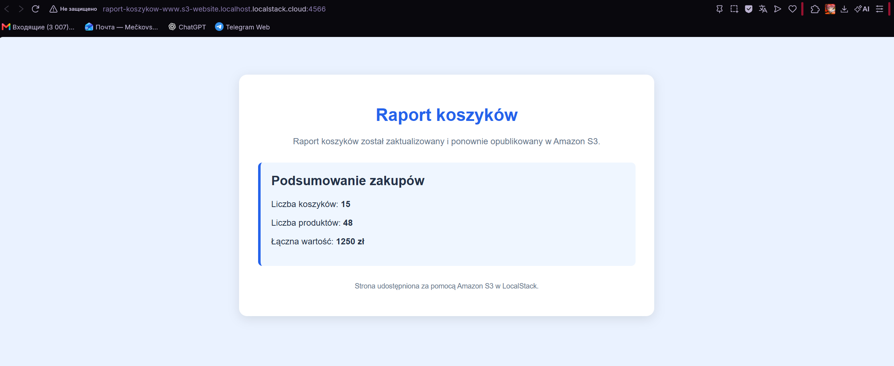
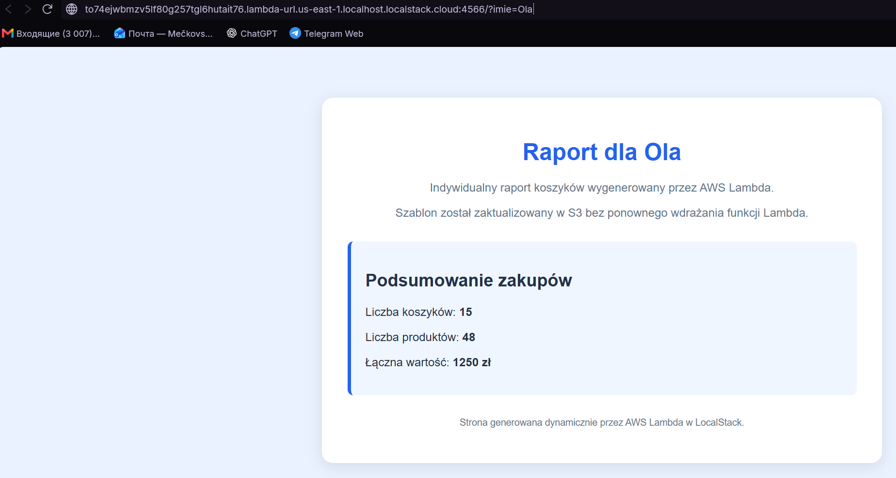
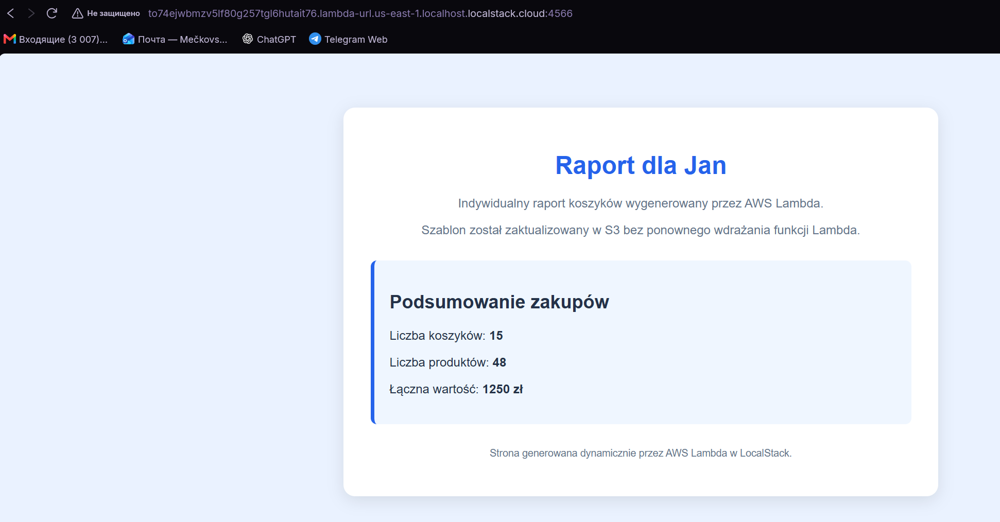

# Laboratorium 2 – Jedna strona, dwa sposoby udostępnienia

**Temat:** Publikacja raportu koszyków przez S3 Website oraz AWS Lambda Function URL w LocalStack  
**Data wykonania:** 17.11.2026  
**Środowisko:** Windows 11, PowerShell, Visual Studio Code, Docker Desktop, LocalStack, AWS CLI

## 1. Cel laboratorium

Celem ćwiczenia było udostępnienie strony „Raport koszyków” na dwa sposoby: jako statycznej witryny hostowanej przez S3 oraz jako dynamicznego dokumentu HTML zwracanego przez AWS Lambda. Usługi uruchomiono lokalnie za pomocą LocalStack. Sprawdzono także możliwość aktualizacji plików bez zmiany adresów stron, poprawność odpowiedzi HTTP i bezpieczne podstawianie danych w HTML.

## 2. Uruchomienie środowiska

Wykorzystano Docker Desktop z silnikiem Docker 29.9.3 oraz Docker Compose 5.7.0. LocalStack uruchomiono z pliku `compose.yaml`, z portem `4566` udostępnionym wyłącznie na `127.0.0.1`. Do obsługi funkcji Lambda udostępniono kontenerowi gniazdo Dockera (`/var/run/docker.sock`). Token autoryzacyjny przechowywany jest w lokalnym pliku `.env`, wyłączonym z repozytorium przez `.gitignore`.

```powershell
docker --version
docker compose version
docker info
docker compose up -d
docker compose ps
curl.exe http://localhost:4566/_localstack/health
```

Kontener `localstack-main` został uruchomiony, a endpoint kontroli stanu odpowiadał dokumentem JSON zawierającym m.in. usługi `s3` i `lambda` oznaczone jako `available`. Użyta instancja LocalStack zgłaszała wersję `2026.10.7` (edycja Pro).

Do pracy z lokalnym emulatorem użyto AWS CLI 2.40.4. W sesji PowerShell ustawiono testowe wartości zmiennych środowiskowych (nie są to prawdziwe dane dostępowe do AWS):

```powershell
$env:AWS_ACCESS_KEY_ID="test"
$env:AWS_SECRET_ACCESS_KEY="test"
$env:AWS_DEFAULT_REGION="us-east-1"
aws --endpoint-url=http://localhost:4566 s3 ls
```

Początkowo lista bucketów była pusta; polecenie zakończyło się bez błędu.

## 3. Wariant I – statyczna strona S3 Website

W folderze `www/` utworzono `index.html` i osobny arkusz `style.css`. Strona zawiera nagłówek „Raport koszyków”, krótki opis i przykładowe podsumowanie zakupów. Arkusz CSS wprowadza widoczną zmianę wyglądu: jasnoniebieskie tło, białą kartę i niebieskie akcenty.

**Bucket:** `raport-koszykow-www`  
**Dokument startowy:** `index.html`

Wykonane polecenia:

```powershell
aws --endpoint-url=http://localhost:4566 s3 mb s3://raport-koszykow-www
aws --endpoint-url=http://localhost:4566 s3 ls
aws --endpoint-url=http://localhost:4566 s3 cp .\www\index.html s3://raport-koszykow-www/index.html --content-type "text/html"
aws --endpoint-url=http://localhost:4566 s3 cp .\www\style.css s3://raport-koszykow-www/style.css --content-type "text/css"
aws --endpoint-url=http://localhost:4566 s3 ls s3://raport-koszykow-www/
aws --endpoint-url=http://localhost:4566 s3 website s3://raport-koszykow-www/ --index-document index.html
aws --endpoint-url=http://localhost:4566 s3api get-bucket-website --bucket raport-koszykow-www
aws --endpoint-url=http://localhost:4566 s3api put-bucket-policy --bucket raport-koszykow-www --policy file://bucket-policy.json
```

Plik `bucket-policy.json` zezwala na publiczne pobieranie obiektów (`s3:GetObject`) z ćwiczeniowego bucketu witryny. Został dołączony do projektu.

**Adres witryny:**  
`http://raport-koszykow-www.s3-website.localhost.localstack.cloud:4566/`

Po pierwszym opublikowaniu zmieniono opis strony na: „Raport koszyków został zaktualizowany i ponownie opublikowany w Amazon S3.” Następnie ponownie przesłano `index.html`:

```powershell
aws --endpoint-url=http://localhost:4566 s3 cp .\www\index.html s3://raport-koszykow-www/index.html --content-type "text/html"
```

Po odświeżeniu witryny pod niezmienionym adresem widoczny był nowy tekst i poprawnie zastosowane style.



*Rys. 1. Statyczna strona S3 Website z paskiem adresu, działającym stylem CSS i zaktualizowanym opisem.*

## 4. Wariant II – szablon S3 i funkcja AWS Lambda

W osobnym buckecie `raport-koszykow-szablony` umieszczono plik `template.html`. Szablon zawiera osadzone style CSS oraz znacznik `{{IMIE}}` w nagłówku `Raport dla {{IMIE}}`. Bucket szablonów pozostawiono bez publicznej polityki odczytu.

```powershell
aws --endpoint-url=http://localhost:4566 s3 mb s3://raport-koszykow-szablony
aws --endpoint-url=http://localhost:4566 s3 cp .\lambda\template.html s3://raport-koszykow-szablony/template.html --content-type "text/html"
aws --endpoint-url=http://localhost:4566 s3 ls s3://raport-koszykow-szablony/
aws --endpoint-url=http://localhost:4566 s3 cp s3://raport-koszykow-szablony/template.html - | Select-String "IMIE"
```

Wynik odczytu pliku z S3 zawierał:

```html
<h1>Raport dla {{IMIE}}</h1>
```

W pliku `lambda/lambda_function.py` utworzono funkcję w Pythonie. Funkcja odczytuje parametr `imie` z `queryStringParameters`, zwraca kod `400` przy jego braku lub pustej wartości, pobiera szablon z S3 przy prawidłowym żądaniu, zamienia `{{IMIE}}` na bezpiecznie zakodowaną wartość przez `html.escape()` i zwraca HTML z kodem `200` i `Content-Type: text/html; charset=utf-8`.

**Nazwa funkcji:** `raport-koszykow-lambda`  
**Runtime:** `python3.12`  
**Handler:** `lambda_function.lambda_handler`

Wdrożenie wykonano z paczki ZIP zawierającej kod funkcji (bez szablonu HTML):

```powershell
Compress-Archive -Path .\lambda\lambda_function.py -DestinationPath .\lambda-function.zip -Force
Get-Item .\lambda-function.zip
aws --endpoint-url=http://localhost:4566 lambda create-function --function-name raport-koszykow-lambda --runtime python3.12 --handler lambda_function.lambda_handler --role arn:aws:iam::000000000000:role/lambda-role --zip-file fileb://lambda-function.zip --timeout 30
aws --endpoint-url=http://localhost:4566 lambda wait function-active-v2 --function-name raport-koszykow-lambda
aws --endpoint-url=http://localhost:4566 lambda get-function --function-name raport-koszykow-lambda --query "Configuration.[FunctionName,Runtime,State]" --output table
```

Po zakończeniu wdrożenia funkcja miała stan `Active`.

Utworzono Function URL i skonfigurowano uprawnienia wywołania w lokalnym środowisku:

```powershell
aws --endpoint-url=http://localhost:4566 lambda create-function-url-config --function-name raport-koszykow-lambda --auth-type NONE
aws --endpoint-url=http://localhost:4566 lambda add-permission --function-name raport-koszykow-lambda --statement-id PublicFunctionUrl --action lambda:InvokeFunctionUrl --principal "*" --function-url-auth-type NONE
aws --endpoint-url=http://localhost:4566 lambda add-permission --function-name raport-koszykow-lambda --statement-id PublicFunctionInvoke --action lambda:InvokeFunction --principal "*" --invoked-via-function-url
aws --endpoint-url=http://localhost:4566 lambda get-function-url-config --function-name raport-koszykow-lambda --query FunctionUrl --output text
```

**Adres funkcji w tej instancji LocalStack:**  
`http://to74ejwbmzv5lf80g257tgl6hutait76.lambda-url.us-east-1.localhost.localstack.cloud:4566/`

### 4.1. Wyniki w przeglądarce

Wywołanie `?imie=Ola` wyświetliło nagłówek „Raport dla Ola”, natomiast `?imie=Jan` – „Raport dla Jan”.



*Rys. 2. Odpowiedź funkcji Lambda dla parametru `imie=Ola`.*



*Rys. 3. Odpowiedź funkcji Lambda dla parametru `imie=Jan`.*

### 4.2. Testy odpowiedzi HTTP

Adres funkcji zapisano do zmiennej:

```powershell
$url = aws --endpoint-url=http://localhost:4566 lambda get-function-url-config --function-name raport-koszykow-lambda --query FunctionUrl --output text
```

**Poprawne żądanie:**

```powershell
curl.exe -s -D - -o NUL "${url}?imie=Ola"
```

Zaobserwowany fragment odpowiedzi:

```http
HTTP/1.1 200 OK
Content-Type: text/html; charset=utf-8
```

**Żądanie bez parametru `imie`:**

```powershell
curl.exe -i "$url"
```

Zaobserwowany fragment odpowiedzi:

```http
HTTP/1.1 400 BAD REQUEST
Content-Type: text/plain; charset=utf-8

Podaj imie w adresie, np. ?imie=Ola
```

Sprawdzono również pusty parametr `?imie=` – przeglądarka pokazała komunikat o konieczności podania imienia.

**Test znaków specjalnych w HTML:**

```powershell
curl.exe -s "${url}?imie=%3Cscript%3Ealert(1)%3C%2Fscript%3E" | Select-String "Raport dla"
```

Zaobserwowano bezpieczne zakodowanie znaków HTML:

```html
<h1>Raport dla &lt;script&gt;alert(1)&lt;/script&gt;</h1>
```

### 4.3. Aktualizacja szablonu bez wdrażania funkcji

Do `lambda/template.html` dodano zdanie: „Szablon został zaktualizowany w S3 bez ponownego wdrażania funkcji Lambda.” Następnie przesłano tylko zmieniony obiekt:

```powershell
aws --endpoint-url=http://localhost:4566 s3 cp .\lambda\template.html s3://raport-koszykow-szablony/template.html --content-type "text/html"
```

Odświeżenie strony Function URL pokazało nowe zdanie bez wykonywania `lambda update-function-code` ani ponownego tworzenia funkcji. Zmiana została również potwierdzona odczytem obiektu z S3 (poniżej).

Na koniec odczytano obiekt z S3:

```powershell
aws --endpoint-url=http://localhost:4566 s3 cp s3://raport-koszykow-szablony/template.html - | Select-String "IMIE|zaktualizowany"
```

W wyniku nadal znajdował się znacznik `{{IMIE}}` oraz dodane zdanie. W terminalu niektóre polskie znaki były nieprawidłowo zakodowane, ale w przeglądarce strona wyświetlała je poprawnie.

```html
<h1>Raport dla {{IMIE}}</h1>
```

## 5. Wnioski

W wariancie statycznym gotowe pliki HTML i CSS dostarcza bezpośrednio usługa S3 Website. Jest to wystarczające rozwiązanie, gdy treść strony nie zależy od danych żądania i nie wymaga przetwarzania po stronie serwera. Aktualizacja witryny polega na zastąpieniu obiektu w buckecie.

W wariancie dynamicznym HTML dostarcza funkcja AWS Lambda: po otrzymaniu żądania odczytuje parametr `imie`, pobiera szablon z osobnego bucketu S3 i tworzy odpowiedź. Pozwala to dopasować treść do parametrów żądania oraz zwracać odpowiednie kody HTTP.

Oddzielenie szablonu HTML od kodu Lambda ułatwia aktualizację wyglądu i tekstu bez przebudowy i ponownego wdrażania funkcji. W ćwiczeniu potwierdzono to przez zmianę obiektu `s3://raport-koszykow-szablony/template.html` przy niezmienionym kodzie Lambda. Dodatkowo zastosowanie `html.escape()` zabezpiecza przed interpretowaniem podanego imienia jako kodu HTML.

## 6. Pliki dołączone do repozytorium

- `compose.yaml` – konfiguracja LocalStack w Docker Compose;
- `.gitignore` – wykluczenie sekretów i pliku ZIP;
- `bucket-policy.json` – polityka publicznego odczytu ćwiczeniowej witryny S3;
- `www/index.html` i `www/style.css` – statyczna witryna;
- `lambda/lambda_function.py` – kod funkcji;
- `lambda/template.html` – końcowa wersja szablonu;
- `dowody/02-s3-lambda.md` – niniejszy raport;
- `dowody/01-s3-website.png`, `dowody/02-lambda-ola.png`, `dowody/03-lambda-jan.png` – zrzuty ekranu.

Plik `.env` zawierający token oraz paczka `lambda-function.zip` nie są umieszczane w repozytorium.
